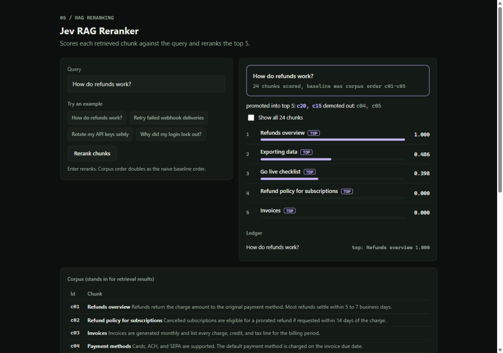

# Jev RAG Reranker

[](https://nodejs.org)
[](#)
[](#)

Jev scores each retrieved chunk against the query and reranks the top 5, with
the promoted and demoted chunks shown against the naive baseline. All 24 chunk
scores are visible, so the ordering is auditable.



## What it does

Ask against a 24-chunk corpus (billing, auth, deploys, refunds, rate limits,
webhooks) and every chunk gets a 0 to 1 relevance score. The top 5 carry a TOP
tag with full bars; the rest stay visible with dimmed bars. A diff line names
what moved: promoted into the top 5, demoted out of it. The naive baseline is
corpus order, standing in for the embedding order a retriever would hand over.
A show-all toggle reveals all 24 rows.

## How the scoring works

BM25-style lexical relevance over stopword-filtered tokens (k1 1.4, b 0.72),
a title-hit bonus, and a fixed bonus when the full query appears contiguously
in the chunk. Scores normalize so the best chunk reads 1.0. For "How do
refunds work?" the refund overview takes 1.000 and the export and go-live
chunks that mention refunds get promoted, while payment methods and disputes
fall out of the baseline. The scorer and corpus are data in `lib/score.js`.

## Quick start

```bash
node server.js
# open http://localhost:3915
```

Node 18 or newer. No install, no keys.

## Tests

```bash
node test.js
```

Six test groups: a refunds query ranks refund content first, determinism,
score range and descending order, top and diff consistency, a stopword-only
query returns all zeros without crashing, and corpus integrity.

## API

```
POST /api/rerank   { query }    all 24 chunks scored and sorted, top and diff
GET  /api/corpus                the chunk list
GET  /api/health               { ok: true }
```

## Docs

Full framework in this repo: [prd.md](prd.md), [trd.md](trd.md),
[architecture.md](architecture.md), [design.md](design.md),
[schema.md](schema.md), [implementation.md](implementation.md),
[rules.md](rules.md).

## Part of the Jev Control Plane

Five demos, one small-model layer that sits in front of an AI agent:

- [Model-Router](https://github.com/trytotest13/Model-Router): which model answers
- [Tool-Risk-Gate](https://github.com/trytotest13/Tool-Risk-Gate): allow, review, or block a tool call
- [Intent-Triage](https://github.com/trytotest13/Intent-Triage): classify a ticket before the agent reasons
- [Loop-Decisions](https://github.com/trytotest13/Loop-Decisions): continue or stop the agent loop
- [RAG-Reranker](https://github.com/trytotest13/RAG-Reranker): rerank retrieved chunks
